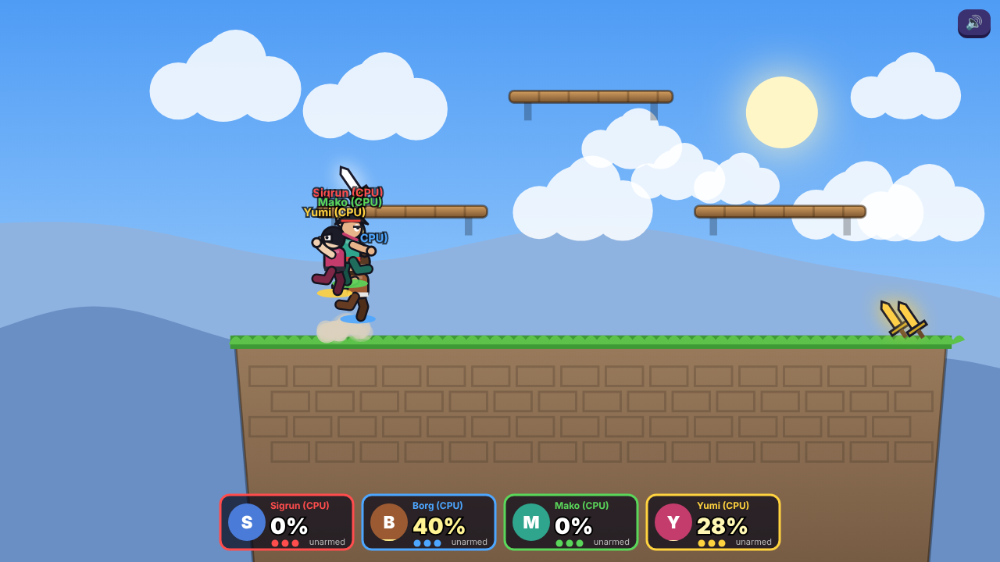

# Brawlheim

A Brawlhalla-style platform fighter that runs in the browser, with **online multiplayer using rollback netcode**, couch co-op (shared keyboard + up to 4 gamepads) and bots.



## Play

```bash
npm install
npm start          # http://localhost:3000
```

* **Quick Play Online** puts you in a public room, or opens one if none is free.
* **Create Private Room** gives you a 4-letter code and an invite link (`?room=CODE`) to send to friends.
* **Local Battle** is 1–4 players on one machine, with any mix of keyboard, gamepads and bots.

`npm run build:standalone` bundles the game into a single offline file, `dist/brawlheim.html`. It has local play and bots but no online multiplayer, and needs no server.

Up to 4 fighters per match. Modes are free-for-all or 2v2 teams, with 1–5 stocks and an optional time limit. People who join a match already in progress spectate it.

To play with friends over the internet, deploy the server anywhere that runs Node and supports WebSockets (Render, Railway, Fly.io, a VPS…). A `Dockerfile` is included and the server honours `PORT`. For the same Wi-Fi, friends open `http://<your-LAN-ip>:3000`.

## Controls

| Action | Keyboard | Alt keys | Gamepad |
|---|---|---|---|
| Move / aim | W A S D | Arrows | Stick / D-pad |
| Jump (3 jumps) | Space / W | Up | A |
| Light attack | J | X, `,`, Num1 | X |
| Heavy / Signature | K | C, `.`, Num2 | B |
| Dodge / Dash | L / Shift | Z, `/`, Num3 | Bumpers / Triggers |
| Pick up / Throw weapon | H | V, M, Num0 | Y |

Like Brawlhalla:
* Damage % goes up with every hit, and higher damage means you fly further.
* Ground heavies are Signatures. In the air, heavy is Recovery and down + heavy is Ground Pound.
* Weapons drop from the sky and each legend has two of them (sword, hammer, spear, gauntlets, blasters).
* You can wall-cling and wall-jump, fast-fall, drop through soft platforms, and dodge in any direction.
* Getting hit refreshes your jumps, dodge and recovery.

## How the multiplayer works

The netcode borrows techniques from games known for good online play:

| Technique | Borrowed from | Where |
|---|---|---|
| **Deterministic lockstep simulation**: same inputs give bit-identical states on every machine. No `Math.random`/`sin`/`cos` in the sim, plus a seeded RNG. | RTS games, GGPO | `shared/sim.js` |
| **Rollback**: remote inputs are predicted (repeat last input). When the real inputs arrive, rewind to the last confirmed state and re-simulate. | GGPO / Street Fighter, Slippi (Melee), Brawlhalla | `public/js/session.js` |
| **Server as input authority**: the server runs the match too and decides the final input for every frame. Inputs that arrive late are replaced with the player's previous input, so one laggy player can't stall the others. | Brawlhalla / modern rollback games with relay servers | `server.js` |
| **Clock dilation**: the server reports how early each client's inputs arrive, and the client speeds up or slows down its clock slightly to keep about 2 frames of buffer. | Overwatch ("Netcode" GDC talk) | `OnlineSession.update` |
| **Fixed timestep** at 60 Hz with catch-up | Glenn Fiedler, "Fix Your Timestep" | server loop / sessions |
| **Desync detection**: the server sends a state hash every 30 frames. A mismatching client gets a full snapshot, which is also how late joiners spectate. | Most lockstep games | `hashState`, `sync`/`snap` |
| **Bots inside the deterministic sim**: bots cost no bandwidth, every client predicts them exactly, and a player who disconnects is taken over by a bot. | Fighting-game CPU players | `botInput` |

The in-game overlay shows ping, rollback depth and input buffer during online matches.

## Tests

```bash
npm test
```

* **Determinism:** full bot matches on every map are deterministic and finish.
* **Snapshots:** clone or JSON snapshot, then re-simulate, gives the same hash.
* **Online sync:** two real WebSocket clients play an online match against the real server, and every server hash must match the client's re-simulation.

## Project layout

```
server.js            HTTP + WebSocket server, lobbies, authoritative input relay
shared/sim.js        the game: physics, moves, weapons, legends, maps, bots (shared by server & browser)
public/js/session.js local session, online rollback session, network wrapper
public/js/render.js  canvas renderer: characters, stages, effects, HUD
public/js/main.js    menus, lobby, game loop
public/js/input.js   keyboard & gamepad
public/js/audio.js   synthesized sound effects (no assets needed)
```

Brawlheim is a fan-made game inspired by Brawlhalla. It is not affiliated with Blue Mammoth Games or Ubisoft, and all characters and art here are original.
